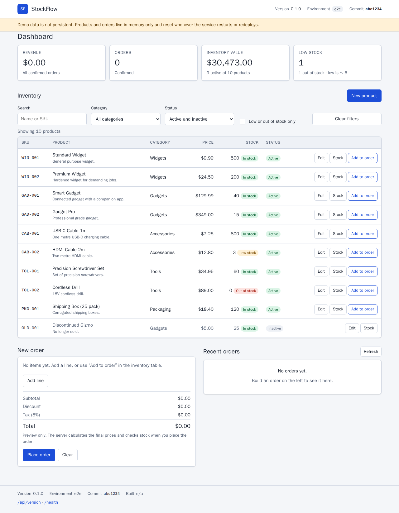
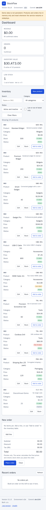
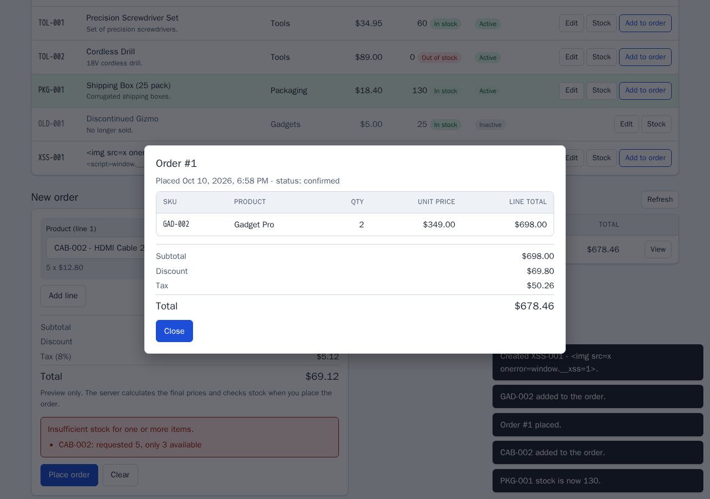
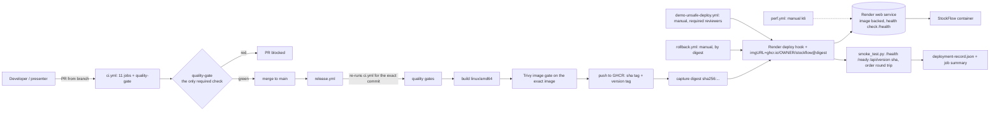

# StockFlow

StockFlow is a small FastAPI inventory and order management app (products, stock, orders, a server-rendered
dashboard). Its real purpose is to be a **complete, demonstrable CI/CD and DevOps lifecycle**:

```
pull request -> quality gates -> merge -> linux/amd64 image -> Trivy -> GHCR (by digest)
             -> Render (image-backed web service) -> smoke test -> deployment record -> manual rollback by digest
```

Everything the pipeline checks is real: ruff, mypy (strict), pytest with branch coverage, Bandit, pip-audit,
Trivy (filesystem, config, image), a container smoke test, and k6. On top of that, a YAML-driven **defect
injection engine** (`python -m demo`) plants reversible, real defects (a lint error, a failing test, a vulnerable
dependency, a slow endpoint, a crashing deployment, ...) so a presenter can show each gate catching the right
problem and then show the fix.



| | |
|---|---|
| Stack | Python 3.12, FastAPI, Pydantic v2, SQLAlchemy 2 (tests/SQLite), Jinja2, uv (committed `uv.lock`) |
| Delivery | GitHub Actions, Docker (linux/amd64), GHCR, Render image-backed web service, k6 |
| Data | Production runs the **in-memory** seeded repository, one worker. **Data is not persistent**: it resets on every restart or deploy, and the dashboard says so. |

## Contents

1. [Screenshots](#screenshots)
2. [Local setup](#local-setup)
3. [Running the tests and quality gates](#running-the-tests-and-quality-gates)
4. [Running Docker](#running-docker)
5. [Architecture](#architecture)
6. [Triggering and resetting defects](#triggering-and-resetting-defects)
7. [CI/CD overview](#cicd-overview)
8. [PR demos (optional previews)](#pr-demos-optional-previews)
9. [Deployment configuration](#deployment-configuration)
10. [Security architecture](#security-architecture)
11. [Limitations (read this)](#limitations-read-this)
12. [Documentation map](#documentation-map)

## Screenshots

Captured with a headless Chromium against a locally running app with the seeded demo data (version 0.1.0).
The header and footer show test metadata (environment `e2e`, commit `abc1234`), not a deployed release.

| Dashboard, desktop | Dashboard, mobile | Order detail (after an insufficient-stock error and a placed order) |
|---|---|---|
|  |  |  |

Files: `docs/images/dashboard-desktop.png`, `docs/images/dashboard-mobile.png`, `docs/images/order-detail.png`.
The frontend interactive flows (filtering, creating a product, placing an order, the insufficient-stock
error, stock adjustment, order detail, XSS-safe rendering of hostile product names) were exercised in a real
headless browser: 15 of 15 checks passed. Nothing beyond that was browser-tested.

How to regenerate them: Playwright is **not** a project dependency (do not add it to `pyproject.toml`). Use a
throwaway script outside the repository:

```bash
mkdir -p /tmp/shots && cd /tmp/shots && python3 -m venv .venv && . .venv/bin/activate
pip install playwright && playwright install chromium     # downloads a browser, outside the repo
(cd /path/to/devops-demo && PORT=8000 uv run python -m app) &   # start the app
cat > shots.py <<'PY'
from playwright.sync_api import sync_playwright
with sync_playwright() as p:
    b = p.chromium.launch()
    for name, w, h in (("dashboard-desktop", 1280, 900), ("dashboard-mobile", 390, 844)):
        page = b.new_page(viewport={"width": w, "height": h})
        page.goto("http://127.0.0.1:8000/")
        page.screenshot(path=f"/path/to/devops-demo/docs/images/{name}.png", full_page=True)
    b.close()
PY
python shots.py
```

`order-detail.png` additionally needs interaction steps (add a line, place an order, click "View"). The script
above illustrates the approach; it was not re-run during the documentation pass. The three committed images
were produced by the orchestrator's headless-Chromium session.

## Local setup

Requirements: [uv](https://docs.astral.sh/uv/) (CI and the image pin 0.13.0), `make`, and for the optional parts Docker,
[Trivy](https://trivy.dev/), [k6](https://k6.io/) and `actionlint` (`make tools` installs pinned,
checksum-verified copies of trivy, actionlint and k6 into `~/.local/bin`). uv uses the Python 3.12 pinned by
`.python-version`.

```bash
export PATH=$HOME/.local/bin:$PATH        # where uv/trivy/k6 live on the dev VM
make sync                                  # == uv sync --frozen (installs from uv.lock)
make run                                   # == uv run python -m app   (http://localhost:8000)
```

Verified output of a local run (`PORT=8131 uv run python -m app`) and the probes:

```
INFO:     Started server process [301424]
INFO:     Application startup complete.
INFO:     Uvicorn running on http://0.0.0.0:8131 (Press CTRL+C to quit)

$ curl -s localhost:8131/api/version
{"name":"stockflow","version":"0.0.0-dev","git_sha":"unknown","environment":"local","build_time":null,"repository":"memory","persistent":false}
$ curl -s localhost:8131/health      -> {"status":"ok"}
$ curl -s localhost:8131/ready       -> {"status":"ready","repository":"memory"}
```

Configuration is environment only (`app/config.py`): `PORT` (default 8000), `APP_VERSION`, `GIT_SHA`,
`BUILD_TIME`, `DEPLOY_ENVIRONMENT`, `REPOSITORY_BACKEND` (`memory` in production). A bare local run reports
version `0.0.0-dev` and sha `unknown`; the Docker image bakes in the real values.

Endpoints: `GET /` (dashboard), `GET /health`, `GET /ready`, `GET /api/version`, `GET /api/metrics`,
`/api/products` (list/create/get/patch, `POST /api/products/{id}/stock`), `/api/orders` (create/list/get).
The full contract is in [docs/ARCHITECTURE.md](docs/ARCHITECTURE.md).

Smoke-test any running instance (the same script the pipeline runs after a deploy):

```
$ make smoke BASE_URL=http://127.0.0.1:8131
uv run python scripts/smoke_test.py --base-url http://127.0.0.1:8131
StockFlow smoke test against http://127.0.0.1:8131
[PASS] health: status ok
[PASS] ready: ready (repository: memory)
[PASS] version: version 0.0.0-dev sha unknown env local (no --expect-sha given)
[PASS] products: 10 product(s)
[PASS] order: order #1 for WID-001 total 10.79 round-tripped
[PASS] dashboard: dashboard rendered
SMOKE TEST PASSED
```

The smoke test places one real order (its only write); the data is in memory.

## Running the tests and quality gates

Every gate is a Make target and every threshold comes from [`config/quality-policy.yaml`](config/quality-policy.yaml)
(see [docs/QUALITY_GATES.md](docs/QUALITY_GATES.md)).

| Command | What it runs | Verified result on the clean baseline |
|---|---|---|
| `make lint` | `ruff check .` | `All checks passed!` |
| `make format-check` | `ruff format --check .` | `73 files already formatted` |
| `make typecheck` | `mypy` (strict) | `Success: no issues found in 36 source files` |
| `make test` | `pytest` (all tests) | `1431 passed` |
| `make test-coverage` | pytest + branch coverage, fails under the policy threshold | `Required test coverage of 85% reached. Total coverage: 100.00%`, `1431 passed` |
| `make security` | policy check, bandit, pip-audit, trivy fs, trivy config | `quality policy OK`; bandit `No issues identified.`; pip-audit `No known vulnerabilities found`; trivy fs and config: 0 findings |
| `make quality` | lint, format-check, typecheck, test-coverage, security | exit 0 |
| `make policy-check`, `make lock-check`, `make workflow-lint` | policy/mirror/drift check, `uv lock --check`, actionlint | all exit 0 |

Wall-clock for the full test suite varies a lot with machine load (about 2 minutes alone; 3 to 6 minutes
while other jobs ran on the same VM).

## Running Docker

Docker needs `sudo` on the dev VM; the Makefile detects that automatically (override with `DOCKER=docker`).
The host is aarch64 and the production target is linux/amd64, so the image is built for `linux/amd64`
(emulated here; a native amd64 CI runner does not emulate).

```bash
make docker-build           # linux/amd64 image stockflow:local
make docker-run             # foreground on http://localhost:8000 (Ctrl+C to stop)
make docker-test            # build + run + smoke test + image guard + graceful stop
make compose-up             # compose (host platform, read-only, cap_drop ALL); make compose-down to stop
```

Verified `make docker-test` result (trimmed; run with `IMAGE=stockflow:docs` in a scratch copy of the repo):

```
== start stockflow:docs (linux/amd64) on host port 49729, container PORT=9123
health status: healthy
== smoke test (expects /api/version git_sha f4a42669891d9d6b5e6122ce7001135a9eb04bfd)
[PASS] health: status ok
[PASS] ready: ready (repository: memory)
[PASS] version: version 0.1.0 sha f4a42669891d env production (matches --expect-sha)
[PASS] products: 10 product(s)
[PASS] order: order #1 for WID-001 total 10.79 round-tripped
[PASS] dashboard: dashboard rendered
SMOKE TEST PASSED
== image guard
PASS  runs as a non-root user (uid 10001)
PASS  no demo/, tests/, load-tests/, docs/, .github/, .demo-state/, scripts/, reports/ in /app
PASS  no DEMO-DEFECT marker in /app
PASS  no git metadata, env files or local databases in /app
PASS  no package installers or build tools (uv, pip, gcc, make, git)
PASS  application code is not writable by the runtime user
PASS  application package is present
[demo] image-guard OK: stockflow:docs has no demo/, fixtures, tests or DEMO-DEFECT markers
== graceful shutdown (SIGTERM -> exit 0 within 10 s)
stopped in 3s with exit code 0
docker-test PASSED: stockflow:docs
```

The image is multi-stage (builder with uv; runtime without pip, uv or compilers), non-root (uid 10001), both
base images pinned by tag and digest, only `app/`, `pyproject.toml` and `uv.lock` in the build context
(allow-list `.dockerignore`), and the git sha, version and build time are baked in as build args and OCI labels.

## Architecture



Application layers: `app/api` (routers, error handlers, dashboard) -> `app/services` (single-purpose modules:
pricing, inventory, orders, products, metrics) -> `app/repository` (Protocol; in-memory for production, SQLite
for tests). Money is `Decimal`, rounded half-up to cents; discount tiers by subtotal; 8% tax on the discounted
subtotal. Full contract: [docs/ARCHITECTURE.md](docs/ARCHITECTURE.md).

## Triggering and resetting defects

Defects are applied to the real source files with reversible, hash-checked text patches from
`demo/scenarios.yaml`. The clean baseline never contains a defect marker (`DEMO-DEFECT:<id>`).

```
$ make demo-list
ID                    CATEGORY    GATE         STAGE        DEPLOY?  NAME
clean                 baseline    all          pr-ci        yes      Clean baseline
bad_lint              lint        ruff         pr-ci        no       Unused import (lint failure)
bad_format            format      ruff-format  pr-ci        no       Badly formatted code (format failure)
bad_typecheck         types       mypy         pr-ci        no       Wrong return annotation (mypy failure)
bad_unit_test         logic       pytest       pr-ci        no       Order total ignores the discount (unit test failure)
bad_integration_test  logic       pytest       pr-ci        no       Orders never decrement stock (integration test failure)
bad_coverage          coverage    coverage     pr-ci        no       Large untested module (coverage gate failure)
bad_security          security    bandit       pr-ci        no       Shell injection in app code (Bandit failure)
bad_dependency        dependency  pip-audit    pr-ci        no       Known-vulnerable runtime dependency (pip-audit + Trivy failure)
bad_container         container   trivy-image  image-build  no       Outdated base image with fixable HIGH/CRITICAL CVEs (Trivy image failure)
slow_api              runtime     k6           post-deploy  yes      Slow product listing (k6 latency threshold failure)
unhealthy_health      runtime     smoke        post-deploy  yes      Health endpoint returns 503 (smoke test failure)
bad_deployment        runtime     smoke        post-deploy  yes      Service crashes at startup (failed deployment)

$ make demo SCENARIO=bad_lint
[demo] inject bad_lint: injected
[demo]   app/services/orders.py
$ make demo-status          # or: uv run python -m demo status
[demo] active scenario: bad_lint (active)
[demo]   app/services/orders.py: injected
$ make lint                 # fails exactly as declared (F401, `os` imported but unused)
$ make demo-reset
[demo] reset bad_lint: restored baseline
```

* Runtime scenarios (`slow_api`, `unhealthy_health`, `bad_deployment`) need `DEMO_ARGS=--allow-runtime-failures`
  to inject and stay **inert** unless the running process has both `STOCKFLOW_DEMO_FAULT=<id>` and
  `STOCKFLOW_DEMO_ALLOW_RUNTIME_FAILURES=true` in its environment.
* `make demo-verify SCENARIO=<id>` proves one scenario in a throw-away copy of the repo (inject, the real gate
  fails as declared, reset, identical tree digest, gate passes). `make demo-verify-all` does all of them and
  takes about ten minutes. `make demo-fixtures` re-checks the vulnerable-dependency and old-base-image fixtures
  against the live advisory databases (needs network); run it before every demo.
* After a reset `python -m demo status` prints `baseline: no scenario active`. The git-ignored `.demo-state/`
  directory may remain (with empty `backup/` and a `lock` file) but holds no `state.json`.
* Never merge a commit that contains `DEMO-DEFECT:`; the baseline guard test and the image guard exist to stop that.

Per-scenario commands, expected output and presenter notes: [docs/DEMO_RUNBOOK.md](docs/DEMO_RUNBOOK.md).

## CI/CD overview

| Workflow | Trigger | What it does |
|---|---|---|
| [`ci.yml`](.github/workflows/ci.yml) | pull request to `main`, push to `main`, manual, reusable | 11 jobs: `config-validation`, `lint-format`, `typecheck`, `unit-tests`, `integration-tests`, `coverage`, `bandit`, `dependency-audit`, `trivy-fs-scan`, `docker-build`, `trivy-image-scan`; plus **`quality-gate`**, the only check branch protection needs (it passes only when every job is exactly `success`). No secrets are used (fork-safe). |
| [`release.yml`](.github/workflows/release.yml) | push to `main`, manual (`require_deploy`) | re-runs `ci.yml` for that commit; `build-scan` (build amd64, run + smoke test + image guard, Trivy on the exact image); `publish` (the only job with `packages: write`: pushes the `sha-<sha>` and `<version>` tags, captures the digest, verifies the registry's OCI labels, writes `release-record.json`); `deploy` (environment `production`: preflight, deploy hook with `imgURL=ghcr.io/<owner>/stockflow@sha256:...`, smoke test with `--expect-sha`, then `release_tools.py verify-deployment`, which requires the release record, the digest sent in `imgURL` and the live `/api/version` to agree on digest, commit, version and name; `deployment-record.json`). **Deployment is mandatory on every push to `main`**: a run is green only after all of that passed. |
| [`rollback.yml`](.github/workflows/rollback.yml) | manual: `image_digest`, `reason` | verifies the digest exists in GHCR, redeploys exactly that digest (no rebuild), verifies `/api/version.git_sha` equals the restored image's sha, records it. Fails loudly if it cannot run. |
| [`demo-unsafe-deploy.yml`](.github/workflows/demo-unsafe-deploy.yml) | manual only, from `main`, typed confirmation | **Demonstration only.** Deploys an already-published broken image by digest through environment `demo-unsafe` (configure required reviewers). A red run is the expected result. |
| [`pr-preview.yml`](.github/workflows/pr-preview.yml) | pull request events (labeled, unlabeled, synchronize, reopened, closed) | **Opt-in PR demos.** Only a PR from this repository (never a fork or Dependabot) that carries the label `preview` gets a Render image preview, built from the PR head, scanned with the same Trivy gate, pushed as `ghcr.io/<owner>/stockflow:pr-<n>` and `:pr-<n>-<sha7>`, and deployed **by digest** only after a green `quality-gate` for that head commit. The label-then-close path was run for real on GitHub and Render on 2026-10-12 (PR #3); other paths are NOT VERIFIED. See [PR demos](#pr-demos-optional-previews). |
| [`perf.yml`](.github/workflows/perf.yml) | manual, typed `WRITE` confirmation | k6 against `STOCKFLOW_BASE_URL`; it writes products and orders on the target. |

Properties: third-party actions pinned to full commit SHAs; top-level `permissions: contents: read` with write
permissions only per job where the policy allows; deploys serialised (`deploy-production`, never cancelled);
a hook answering 200 means *accepted*, never *deployed* (deployment is proven by `/api/version` and the smoke
test plus the `verify-deployment` cross-check). Deployment is **mandatory**: if the Render hook secret
(`RENDER_DEPLOY_HOOK_URL`, `production` environment) or the variable `STOCKFLOW_BASE_URL` is missing, the image is
still built, scanned and published to GHCR first, and then the `deploy` job **fails** (red) with
"Deployment is mandatory but not configured" / "DEPLOYMENT FAILED: not configured (deployment is mandatory)".
That is deliberate: a release can never look green without a verified deployment. The manual `release` run has
`require_deploy` defaulting to true; setting it to false is the only opt-out and only warns. Bootstrap order:
[docs/SETUP_GITHUB_RENDER.md](docs/SETUP_GITHUB_RENDER.md#4-bootstrap--first-push-and-first-release).
(This behaviour comes from the workflow and scripts; it was not run on GitHub.)

## PR demos (optional previews)

**Status: the main path was run for real on GitHub and Render (2026-10-12); the rest is NOT VERIFIED.** Observed on 2026-10-12 with PR #3 (labelled `preview`, then closed): `pr-preview` run 38209130008 passed every job (`decide`, `gate`, `build-scan`, `publish`, `preview`, `report`); the `gate` job waited for a green `quality-gate`; the sticky comment read "DEPLOYED and verified" with URL `https://stockflow-pr-3.onrender.com`, commit `8cbaf837c419` and digest `sha256:41d40667...`; Render created a separate service `stockflow-pr-3` (parent = the base service) on the **free** plan with `imagePath` `ghcr.io/sixseven-pranav-jothivel/stockflow@sha256:<digest>`; `/api/version` served version `0.1.0-pr3` and the PR head sha; closing the PR started cleanup run 38209469656 (success), the Render service was deleted (checked through the Render API: only the base service remained) and the comment became "Preview deleted". The preview reported `environment: production` because previews inherit the base service's environment variables (a known cosmetic limitation).

**Still NOT VERIFIED (never exercised):** removing the label (the `unlabeled` path), a new commit redeploying an existing preview (`synchronize`), the cleanup race branches, the fork and Dependabot guards on real events, and the gate timeout. Every closed PR also starts a `cleanup` run (it exits quickly when the PR had no preview).

* **Opt-in per PR.** Add the repository label `preview` to a pull request. PRs from forks and from Dependabot
  never get one; PRs without the label never get one.
* **Gated.** The `pr-preview` workflow first waits for a green `quality-gate` check on the exact head commit.
  Then it builds the linux/amd64 image from the PR head (no secrets in that job), runs the container smoke test and
  image guards, applies the same Trivy image gate, pushes `ghcr.io/<owner>/stockflow:pr-<n>` and
  `:pr-<n>-<sha7>`, and creates or redeploys a Render preview **by digest** through Render's API
  (`POST /v1/services/{id}/preview`, base service = the production service). It then smoke-tests the preview with
  `--expect-sha` set to the PR head commit.
* **One sticky PR comment** shows the status and the preview URL (or why there is none, for example
  `quality-gate FAILED for this commit`).
* **Cleanup.** Closing the PR or removing the label deletes the preview. Render never deletes image previews by
  itself; if the cleanup fails the comment names the service (`stockflow-pr-<n>`) to delete by hand.
* **Needs** the `preview` environment with secrets `RENDER_API_KEY` and `RENDER_SERVICE_ID` (the base service
  id) and optionally the variable `PREVIEW_PLAN`. A labelled PR on a repository without them fails with
  `NOT DEPLOYED: preview not configured`. Setup: [docs/SETUP_GITHUB_RENDER.md](docs/SETUP_GITHUB_RENDER.md#8-optional-per-pr-preview-environments).
* **Render-side facts, now observed (2026-10-12):** a preview of a free image-backed base service can itself be on the
  free plan; Render's preview API accepts the `repo@sha256:<digest>` form of `imagePath`; the preview URL is
  `https://<service-name>.onrender.com` with the name `stockflow-pr-<n>`; previews inherit the base service's
  environment variables (so the preview's `/api/version` and dashboard say environment `production`). A preview is a
  separate Render service with its own in-memory data.
* Trade-off: this needs a Render API key, which is more powerful than the deploy hook. Read the risk notes in
  the setup guide before enabling it.

## Deployment configuration

* Registry: `ghcr.io/<owner>/stockflow`, owner lowercase (`sixseven-pranav-jothivel` for this repository).
  The package must be **public** so Render can pull it without credentials.
* Render: an image-backed web service, health check path `/health`, exactly one instance. Render never
  redeploys an image-backed service by itself when a new image appears; the pipeline triggers the service's
  deploy hook with `imgURL` set to the digest reference. [`render.yaml`](render.yaml) is an optional Blueprint of
  the same settings (replace `OWNER`).
* GitHub: branch protection requiring only `quality-gate`; environments `production` and `demo-unsafe`
  (required reviewers); secret `RENDER_DEPLOY_HOOK_URL` (environment-scoped); variable `STOCKFLOW_BASE_URL`;
  optional secrets `RENDER_API_KEY` and `RENDER_SERVICE_ID`.

Step by step, with the bootstrap / first-push sequence and verification: [docs/SETUP_GITHUB_RENDER.md](docs/SETUP_GITHUB_RENDER.md).

## Security architecture

* **One policy file** ([`config/quality-policy.yaml`](config/quality-policy.yaml)) holds every threshold; the
  Makefile, workflows and scripts read it through `scripts/quality_policy.py`. `make policy-check` fails on drift,
  expired ignores, unpinned actions, forbidden triggers (`pull_request_target`), `continue-on-error`, and write
  permissions outside the allowed workflow and job.
* **Scanners**: Bandit (SAST, `app/`), pip-audit (the exported lock, runtime and dev, any known vulnerability),
  Trivy filesystem (vulnerabilities and secrets), Trivy config (Dockerfile/IaC), Trivy image (amd64,
  vulnerabilities and secrets). Ignores need an id, a justification and an expiry.
* **Image**: non-root, pinned base digests, no package manager or compiler in the runtime stage, read-only code,
  and an image guard that fails if `demo/`, tests, docs, `.github/` or any `DEMO-DEFECT` marker is inside it.
* **Pipeline**: least-privilege tokens, secrets only in the deploy jobs and scoped to environments, the deploy
  hook URL is masked and never printed, and the image that is pushed is the image that was scanned.
* **Defect engine**: never touches `config/`, `.trivyignore`, workflows or the Makefile; runtime faults need two
  environment keys and never read request data.

Details and the threat model: [docs/SECURITY.md](docs/SECURITY.md).

## Limitations (read this)

* **Demo data is not persistent.** Production is one worker with an in-memory repository: every restart,
  redeploy or free-tier spin-down loses all products and orders (the dashboard shows a banner saying so). The
  repository interface allows a managed database later; none is configured.
* **No authentication and no rate limiting.** It is a public demo app with seeded data.
* **Most GitHub and Render behaviour was not verified live.** The workflows were checked with actionlint; the helper
  scripts and their unit tests run in the suite; the deploy logic was exercised locally (`deploy_render.py
  --dry-run`, a `--provenance=false` image pushed to a throw-away local registry, label reading). Observed for real
  on 2026-10-12: the PR-preview label-then-close path (PR #3, runs 38209130008 and 38209469656, see above) and a
  production release run with Render API polling (`RENDER_API_KEY` and `RENDER_SERVICE_ID` in the `production`
  environment: the poll saw the deploy go `update_in_progress` then `live`, and the image digest matched). Everything
  else (branch protection, the demo-unsafe and rollback workflows, the other preview paths, and so on) is NOT VERIFIED;
  treat [docs/SETUP_GITHUB_RENDER.md](docs/SETUP_GITHUB_RENDER.md) as the checklist and expect to adjust to what the
  live UIs show.
* **Render free tier** spins a service down after 15 minutes without traffic and needs about a minute to start
  again (Render's documentation); warm it before a demo. A free image-backed base service and free-plan previews of it
  were observed working on 2026-10-12.
* **Render does not roll back automatically.** A new instance receives no traffic until `/health` passes and the
  old one keeps serving; if the new one never becomes healthy Render cancels the deploy after 15 minutes. A
  broken image that still answers `/health` goes live. Recovery is `rollback.yml`.
* Some defects are only caught by some signals: the `bad_unit_test` logic bug is caught by the tests but would
  not be caught by the post-deploy smoke test or the k6 test, which only place single-unit orders below the
  discount tier.
* Vulnerability results change over time (the advisory databases are fetched at run time); run
  `make demo-fixtures` before a demo.
* Images are not signed and carry no SBOM attestation.

## Documentation map

| Document | Purpose |
|---|---|
| [docs/ARCHITECTURE.md](docs/ARCHITECTURE.md) | The contract: API, models, pipeline, defect architecture, gate matrix |
| [docs/SECURITY.md](docs/SECURITY.md) | Threat model, scanner policy, permissions, exceptions, known limitations |
| [docs/QUALITY_GATES.md](docs/QUALITY_GATES.md) | Gate matrix: Make target, CI job, policy key, what blocks what |
| [docs/DEMO_RUNBOOK.md](docs/DEMO_RUNBOOK.md) | 14-stage presenter script, 35 to 45 minute timeline, fallbacks |
| [docs/SETUP_GITHUB_RENDER.md](docs/SETUP_GITHUB_RENDER.md) | GitHub and Render setup and first release |
| [docs/TROUBLESHOOTING.md](docs/TROUBLESHOOTING.md) | Failure table |
| [docs/IMPLEMENTATION_STATUS.md](docs/IMPLEMENTATION_STATUS.md) | What is done and verified |
| [demo/README.md](demo/README.md) | Defect-injection engine reference |
| [CLAUDE.md](CLAUDE.md) | Short guide for coding agents |
