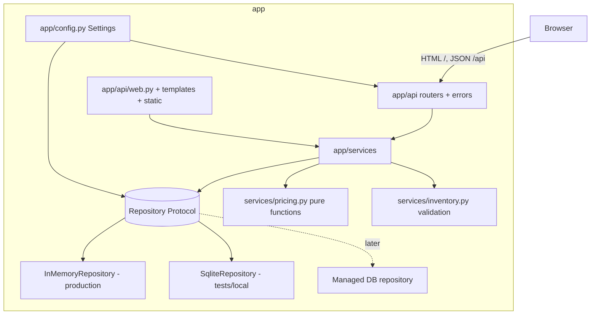
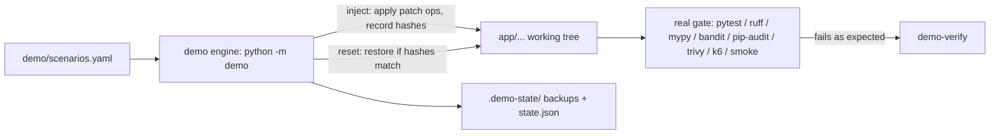
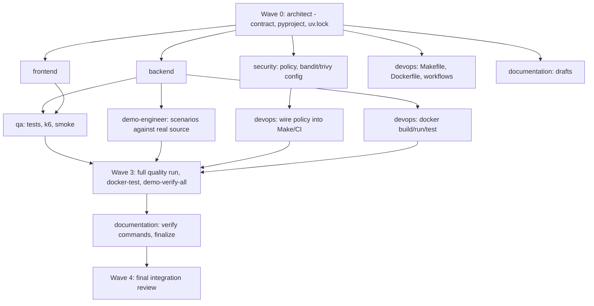

# StockFlow Architecture (the contract)

This document is the single contract for all agents. If code and this document disagree, fix the code or
request a change to this document through your report to the architect. Sections 1-9 define the
application; sections 10-14 define delivery, defect injection, quality gates and ownership.

Python 3.12+, FastAPI, Pydantic v2, SQLAlchemy 2, Jinja2, uv (committed `uv.lock`), Ruff, Mypy (strict),
Pytest + pytest-cov + HTTPX, Bandit, pip-audit, Trivy, Docker, GitHub Actions, GHCR, Render (image-backed
web service), k6.

Runtime dependencies are exactly: fastapi, uvicorn (plain, h11), jinja2, pydantic, pydantic-settings,
sqlalchemy. `pyyaml` (+ `types-PyYAML`) is a **dev-only** dependency: only `demo/` and
`scripts/quality_policy.py` read YAML, so it never enters the production image.

Status of this document: synchronised with the implemented repository (backend, frontend, QA, devops,
security, demo-engineer deliverables) on 2026-10-10. Sections 10 and 11 describe what the workflows and the
demo engine actually do.

---------------------------------------------------------------------------------------------------

## 1. Architecture diagrams

### 1.1 Runtime and delivery

```mermaid
flowchart LR
    Dev[Developer / demo presenter] -->|PR| CI[GitHub Actions: ci.yml]
    CI -->|lint format typecheck test+cov bandit pip-audit trivy-fs| Gate{All gates green?}
    Gate -- no --> Block[PR blocked]
    Gate -- yes --> Main[merge to main]
    Main --> Rel[release.yml]
    Rel --> RCI[job ci: re-run ci.yml for this commit]
    RCI --> Build[job build-scan: buildx linux/amd64, run image, image guard]
    Build --> Scan[Trivy gate on the saved image tarball]
    Scan -->|pass: docker save tarball| Push[job publish: docker load, tag sha + version, push to GHCR]
    Push --> Digest[Digest parsed from docker push output]
    Digest --> Hook[job deploy: Render deploy hook + imgURL=repo@digest]
    Hook --> Smoke[scripts/smoke_test.py retries until /health /ready /api/version sha match]
    Smoke --> Rec[Record: deployment-record.json artifact + job summary]
    Rec -. failure .-> Rb[rollback.yml: manual, by digest]
    Rb --> Hook
    Hook --> Render[(Render web service - image backed)]
    Render --> App[StockFlow container :PORT]
```



### 1.2 Application layers



### 1.3 Defect injection



---------------------------------------------------------------------------------------------------

## 2. Directory structure (final, as implemented)

```
.
|-- CLAUDE.md                          architect
|-- README.md                          documentation
|-- pyproject.toml, uv.lock            architect (pytest/coverage sections: qa)
|-- .python-version                    architect (3.12)
|-- .gitignore                         architect
|-- Makefile                           devops
|-- Dockerfile, .dockerignore          devops (allow-list context: app/, pyproject.toml, uv.lock)
|-- compose.yaml, render.yaml          devops (render.yaml is an optional Blueprint for the image-backed service)
|-- .trivyignore                       security
|-- .github/
|   |-- workflows/                     devops: ci.yml, release.yml, rollback.yml, pr-preview.yml, demo-unsafe-deploy.yml, perf.yml, demo-fixtures.yml
|   |-- actions/                       devops: setup-python-env, setup-trivy (local composite actions)
|   `-- dependabot.yml                 devops
|-- config/                            security: quality-policy.yaml, bandit.yaml, trivy.yaml
|-- app/
|   |-- __init__.py, __main__.py       backend  (python -m app -> uvicorn on $HOST:$PORT, 1 worker)
|   |-- main.py                        backend  (create_app, module-level `app`)
|   |-- config.py                      backend  (Settings, get_settings)
|   |-- api/                           backend: deps.py, errors.py, health.py, meta.py, products.py, orders.py, web.py
|   |-- models/                        backend: domain.py, schemas.py, errors.py
|   |-- repository/                    backend: base.py, memory.py, sqlite.py, seed.py, factory.py
|   |-- services/                      backend: pricing.py, inventory.py, orders.py, products.py, metrics.py
|   |-- templates/                     frontend: base.html, index.html, partials/_macros.html, _orders_rows.html, _products_rows.html
|   `-- static/                        frontend: css/app.css (precompiled, committed), js/app.js
|-- demo/                              demo-engineer: __main__.py, cli.py, engine.py, inject.py, reset.py, verify.py,
|                                      fixtures_check.py, scenarios.yaml, README.md, fixtures/<scenario>/...
|-- tests/                             qa (tests/demo/ -> demo-engineer; tests/deploy/ -> devops)
|   |-- conftest.py, helpers.py
|   |-- unit/                          pricing, inventory, schemas, config            (marker: unit)
|   |-- services/                      orders, products, metrics services             (integration)
|   |-- repository/                    contract suite on memory + SQLite              (integration)
|   |-- api/                           products, orders, health/meta, web, errors     (integration)
|   |-- invariants/                    atomicity, snapshots, concurrency              (integration, concurrency)
|   |-- demo/                          defect engine, baseline-clean guard, runtime gating (demo)
|   |-- deploy/                        deploy_lib / release_tools CLI                 (unit)
|   `-- test_contract.py, test_entrypoint.py, test_quality_policy.py, test_smoke_script.py
|-- load-tests/                        qa: smoke.js, performance.js (k6)
|-- scripts/
|   |-- smoke_test.py                  qa (stdlib only)
|   |-- quality_policy.py              security (get | args | check)
|   `-- deploy/                        devops: deploy_render.py, deploy_lib.py, release_tools.py, preview_lib.py,
|                                      preview_tools.py, docker_test.sh, image_guard.sh, install_tool.sh, summarize.sh
`-- docs/
    |-- ARCHITECTURE.md, IMPLEMENTATION_STATUS.md   architect
    |-- SECURITY.md                    security
    `-- QUALITY_GATES.md, DEMO_RUNBOOK.md, SETUP_GITHUB_RENDER.md, TROUBLESHOOTING.md   documentation
```

Generated, git-ignored: `.venv/`, `reports/` (all tool output: coverage.xml, junit-*.xml, bandit.txt,
pip-audit.txt, trivy-*.txt/json, image.tar, k6 summary, demo-verify.json), `.demo-state/`.

---------------------------------------------------------------------------------------------------

## 3. Configuration (`app/config.py`)

`pydantic-settings`, no env prefix (so the Render/Docker names below are literal), `extra="ignore"`.
`get_settings()` is `functools.lru_cache`d; tests build `Settings(...)` directly and pass it to `create_app`.

| Field | Env var | Type / default | Notes |
|---|---|---|---|
| `app_version` | `APP_VERSION` | `str = "0.0.0-dev"` | baked into image by CI |
| `git_sha` | `GIT_SHA` | `str = "unknown"` | full 40-char sha in CI |
| `build_time` | `BUILD_TIME` | `str \| None = None` | ISO 8601 |
| `deploy_environment` | `DEPLOY_ENVIRONMENT` | `str = "local"` | `local`, `ci`, `production` |
| `port` | `PORT` | `int = 8000` | Render injects it (default 10000) |
| `host` | `HOST` | `str = "0.0.0.0"` | bind address (bandit B104 is accepted: container bind, documented) |
| `repository_backend` | `REPOSITORY_BACKEND` | `Literal["memory","sqlite"] = "memory"` | production uses `memory` |
| `database_url` | `DATABASE_URL` | `str = "sqlite:///./stockflow.db"` | only for `sqlite` |
| `seed_data` | `SEED_DATA` | `bool = True` | seed on empty repository |
| `tax_rate` | `TAX_RATE` | `Decimal = Decimal("0.08")` | validated `0 <= x <= 1` |
| `low_stock_threshold` | `LOW_STOCK_THRESHOLD` | `int = 5` | `quantity_in_stock <= threshold` is "low" |

Rules: no secrets in the app; no setting selects a defect or fault; baseline code has **no** fault hooks
(section 11.5).

Production = in-memory repository, **single worker**, data resets on restart/deploy. The UI banner and
`/api/version` (`"persistent": false`) must state this.

---------------------------------------------------------------------------------------------------

## 4. Domain models (`app/models/domain.py`)

Pydantic v2, `model_config = ConfigDict(frozen=True)`. Timestamps are timezone-aware UTC, serialised as
ISO 8601 with `Z` (e.g. `2026-01-15T10:30:00Z`). IDs are positive integers assigned by the repository
(per-entity auto-increment starting at 1).

```python
from decimal import Decimal
from typing import Annotated, Literal
from datetime import datetime
from pydantic import AfterValidator, BaseModel, ConfigDict, Field, PlainSerializer

# Money: Decimal with <= 2 decimal places, >= 0 for inputs. JSON output is always a 2dp string "19.99".
Money = Annotated[
    Decimal,
    Field(max_digits=12, decimal_places=2, ge=0),
    PlainSerializer(lambda d: f"{d:.2f}", return_type=str, when_used="json"),
]

class Product(BaseModel):
    model_config = ConfigDict(frozen=True)
    id: int
    sku: str                     # normalised: stripped, upper-case, ^[A-Z0-9][A-Z0-9_-]{1,31}$
    name: str                    # 1..120
    description: str             # 0..1000
    price: Money                 # >= 0
    quantity_in_stock: int       # >= 0
    category: str                # 1..60
    active: bool
    created_at: datetime
    updated_at: datetime

class OrderItem(BaseModel):
    model_config = ConfigDict(frozen=True)
    product_id: int
    sku: str                     # snapshot at order time
    product_name: str            # snapshot at order time
    quantity: int                # > 0
    unit_price: Money            # captured at order time; later price changes never affect it
    line_total: Money            # quantize(unit_price * quantity)

class Order(BaseModel):
    model_config = ConfigDict(frozen=True)
    id: int
    status: Literal["confirmed"]
    line_items: list[OrderItem]
    subtotal: Money
    discount: Money
    tax: Money
    total: Money
    created_at: datetime

class Metrics(BaseModel):
    product_count: int
    active_product_count: int
    low_stock_count: int         # active products with 0 < qty <= threshold
    out_of_stock_count: int      # active products with qty == 0
    inventory_value: Money       # sum(price * qty) over active products
    order_count: int
    revenue_total: Money         # sum(order.total)
    low_stock_threshold: int
```

Invariants (enforced in the layer named):
1. `price >= 0` - schema validation (422) and service.
2. Order line `quantity > 0` - schema (`gt=0`, `le=10000`).
3. Orders cannot exceed stock - `services/inventory.py` (409 `insufficient_stock`) + repository guard.
4. Decimal money only; floats never appear. All rounding via `pricing.quantize_money`.
5. Order creation + stock decrement atomic - single `UnitOfWork` (section 6).
6. Unit price captured at order time (copied from product inside the unit of work).
7. Duplicate SKU (after normalisation) rejected on create and on PATCH - 409 `duplicate_sku`.
8. A rejected order mutates nothing (validation precedes any write; unit of work rolls back on error).
9. No oversell under concurrency - repository write lock + transaction; SQLite also uses a conditional
   `UPDATE ... WHERE quantity_in_stock >= :n`.

---------------------------------------------------------------------------------------------------

## 5. REST API contract

All JSON, UTF-8. Money values are JSON strings with 2 decimals in responses. Requests accept a JSON string
or number for money (`"19.99"` or `19.99`); more than 2 decimal places or negative -> 422. Request models
use `extra="forbid"`. Content type `application/json`.

### 5.1 Error body (every non-2xx from `/api/*`)

```json
{"error": {"code": "duplicate_sku", "message": "SKU 'WID-001' already exists.", "details": []}}
```

`details` is always a list (possibly empty) of objects. Codes and statuses:

| HTTP | `code` | When | `details` item |
|---|---|---|---|
| 422 | `validation_error` | any request validation failure (FastAPI `RequestValidationError` is converted) | `{"field": "line_items.0.quantity", "message": "Input should be greater than 0"}` |
| 404 | `product_not_found` | unknown product id (path or order line) | `{"product_id": 99}` |
| 404 | `order_not_found` | unknown order id | `{"order_id": 99}` |
| 404 | `not_found` | unknown route | `[]` |
| 405 | `method_not_allowed` | wrong verb | `[]` |
| 409 | `duplicate_sku` | create/PATCH with existing SKU | `{"sku": "WID-001"}` |
| 409 | `product_inactive` | order line references inactive product | `{"product_id": 10, "sku": "OLD-001"}` |
| 409 | `insufficient_stock` | order line exceeds stock (all shortages listed) | `{"product_id": 8, "sku": "TOL-002", "requested": 2, "available": 0}` |
| 409 | `negative_stock` | stock adjustment would drop below 0 | `{"product_id": 3, "current": 2, "delta": -5}` |
| 500 | `internal_error` | unhandled; message is generic, no stack trace | `[]` |

Order-level precedence (first failing category wins, within a category all offenders are listed):
`validation_error` (422) > `product_not_found` (404) > `product_inactive` (409) > `insufficient_stock` (409).

`/health`, `/ready`, `/api/version` use their own simple bodies (below). `GET /` returns HTML.

### 5.2 Endpoints

**GET /health** -> 200 `{"status": "ok"}` (liveness; touches nothing).

**GET /ready** -> 200 `{"status": "ready", "repository": "memory"}`; calls `repository.ping()`;
on failure 503 `{"status": "not_ready", "detail": "<short reason>"}`.

**GET /api/version** -> 200
```json
{"name": "stockflow", "version": "0.1.0", "git_sha": "3f2c...", "environment": "production",
 "build_time": "2026-01-15T10:30:00Z", "repository": "memory", "persistent": false}
```

**GET /api/metrics** -> 200 `Metrics` JSON:
```json
{"product_count": 10, "active_product_count": 9, "low_stock_count": 1, "out_of_stock_count": 1,
 "inventory_value": "30473.00", "order_count": 0, "revenue_total": "0.00", "low_stock_threshold": 5}
```

**GET /api/products** query: `q` (case-insensitive substring of name or sku), `category` (exact,
case-insensitive), `active` (bool), `low_stock` (bool; **only `true` filters**, keeping
`quantity_in_stock <= LOW_STOCK_THRESHOLD` including 0-stock and inactive products; `false` and absent both
mean "no filter"), `limit` (1..200, default 100), `offset` (>=0, default 0). Sorted by `id` ascending. -> 200
```json
{"items": [Product, ...], "total": 10, "limit": 100, "offset": 0}
```
`total` is the count after filters, before pagination.

**POST /api/products** body `ProductCreate`:
```json
{"sku": "wid-003", "name": "Mini Widget", "description": "", "price": "4.50",
 "quantity_in_stock": 20, "category": "Widgets", "active": true}
```
Required: `sku`, `name`, `price`. Defaults: `description=""`, `quantity_in_stock=0`, `category="General"`,
`active=true`. -> 201 `Product` (sku returned normalised `WID-003`), `Location: /api/products/{id}`.
Errors: 422, 409 `duplicate_sku`.

**GET /api/products/{id}** -> 200 `Product` | 404 `product_not_found`.

**PATCH /api/products/{id}** body `ProductUpdate`: any subset of `sku, name, description, price, category,
active` (at least one field, else 422). `quantity_in_stock` is **not** patchable (unknown field -> 422);
use the stock endpoint. Sets `updated_at`. -> 200 `Product` | 404 | 409 `duplicate_sku` | 422. Price
changes never alter existing orders.

**POST /api/products/{id}/stock** body `{"delta": -3, "reason": "cycle count"}`; `delta` int, non-zero,
`|delta| <= 1000000`; `reason` optional string <= 200 (accepted, echoed nowhere, reserved). -> 200
`Product` | 404 | 409 `negative_stock` | 422.

**POST /api/orders** body `OrderCreate`:
```json
{"line_items": [{"product_id": 1, "quantity": 2}, {"product_id": 3, "quantity": 1}]}
```
`line_items`: 1..50 entries, `product_id` int > 0, `quantity` int 1..10000; duplicate `product_id`
entries -> 422 `validation_error`. -> 201 `Order`, `Location: /api/orders/{id}`:
```json
{"id": 1, "status": "confirmed",
 "line_items": [{"product_id": 1, "sku": "WID-001", "product_name": "Standard Widget", "quantity": 2,
                 "unit_price": "9.99", "line_total": "19.98"}],
 "subtotal": "19.98", "discount": "0.00", "tax": "1.60", "total": "21.58",
 "created_at": "2026-01-15T10:30:00Z"}
```
Errors: 422, 404 `product_not_found`, 409 `product_inactive`, 409 `insufficient_stock`. On any error no
stock changes and no order exists.

**GET /api/orders** query `limit` (1..200, default 50), `offset`. Newest first (`id` descending).
-> 200 `{"items": [Order, ...], "total": n, "limit": 50, "offset": 0}`.

**GET /api/orders/{id}** -> 200 `Order` | 404 `order_not_found`.

**GET /** -> 200 HTML dashboard. Template context (backend supplies, frontend consumes) for
`index.html`:

| key | type |
|---|---|
| `request` | Starlette request |
| `app_version`, `git_sha`, `deploy_environment`, `build_time` | `str` / `str \| None` |
| `persistent` | `bool` (False -> show "data is in-memory and resets on restart/deploy" banner) |
| `products` | `list[Product]` (all, id asc) |
| `recent_orders` | `list[Order]` (latest 10) |
| `metrics` | `Metrics` |
| `categories` | `list[str]` sorted distinct |

`tax_rate` (`str(settings.tax_rate)`) is passed in the context. `index.html` uses it for the client-side order
preview only (a display estimate; the server computes the authoritative totals), falling back to `0.08` if absent.

`Metrics` semantics (as implemented): `low_stock_count` counts **active** products with
`0 < quantity_in_stock <= threshold`; `out_of_stock_count` counts active products with 0 stock;
`inventory_value` sums price x quantity over active products only (seed data: `30473.00`).
The `/api/products?low_stock=true` filter is wider (it also returns 0-stock and inactive products).
Unknown HTTP errors that are neither 404 nor 405 use `code: "http_error"`.

Static files mount at `/static` (`app/static/`). The page's JavaScript talks to the `/api/*` endpoints
above (create/edit product, adjust stock, place order, refresh tables) and renders the error body
`error.message`. No CDN assets: precompiled `app/static/css/app.css` is committed.

---------------------------------------------------------------------------------------------------

## 6. Repository layer (`app/repository/`)

### 6.1 Interface (`base.py`)

```python
from contextlib import AbstractContextManager
from typing import Protocol
from app.models.domain import Order, Product
from app.models.schemas import NewOrder, ProductCreate, ProductUpdate

class UnitOfWork(Protocol):
    """Exclusive, all-or-nothing scope. Reads inside see the unit's own staged writes."""
    def get_product(self, product_id: int) -> Product | None: ...
    def decrement_stock(self, product_id: int, quantity: int) -> None:
        """Raises InsufficientStockError if quantity_in_stock < quantity (atomic guard)."""
    def add_order(self, order: NewOrder) -> Order:
        """Assigns id + created_at; returns the stored Order."""

class Repository(Protocol):
    @property
    def backend_name(self) -> str: ...          # "memory" | "sqlite"
    @property
    def persistent(self) -> bool: ...           # False for memory
    def ping(self) -> None: ...                 # raises on failure

    # products
    def create_product(self, data: ProductCreate) -> Product: ...        # DuplicateSkuError
    def get_product(self, product_id: int) -> Product | None: ...
    def list_products(self, *, q: str | None = None, category: str | None = None,
                      active: bool | None = None, low_stock_threshold: int | None = None,
                      limit: int | None = None, offset: int = 0) -> tuple[list[Product], int]: ...
        # low_stock_threshold not None => only products with quantity_in_stock <= threshold
    def update_product(self, product_id: int, changes: ProductUpdate) -> Product: ...
        # ProductNotFoundError, DuplicateSkuError; only fields in changes.model_fields_set change
    def adjust_stock(self, product_id: int, delta: int) -> Product: ...
        # ProductNotFoundError, NegativeStockError; atomic read-modify-write

    # orders
    def unit_of_work(self) -> AbstractContextManager[UnitOfWork]: ...
        # commit on normal exit, rollback on exception (exception propagates)
    def get_order(self, order_id: int) -> Order | None: ...
    def list_orders(self, *, limit: int | None = None, offset: int = 0) -> tuple[list[Order], int]: ...
```

`NewOrder` (in `schemas.py`): `line_items: list[NewOrderItem]`, `subtotal, discount, tax, total: Decimal`;
`NewOrderItem`: `product_id, sku, product_name, quantity, unit_price, line_total`. Status is always
`"confirmed"` and `created_at` comes from the repository clock.

Constructors accept `clock: Callable[[], datetime] = utc_now` so tests can freeze time.

### 6.2 `InMemoryRepository`
- State: `dict[int, Product]`, `dict[int, Order]`, next-id counters, one `threading.RLock` guarding all
  mutations (and reads that must be consistent). Sync FastAPI endpoints run in a threadpool, so the lock
  is mandatory.
- `unit_of_work()` acquires the lock for the whole scope; writes are **staged** (stock overlay + pending
  order) and applied only on successful exit, so an exception leaves state untouched.
- SKU uniqueness via a `dict[str, int]` index kept consistent with products.
- `persistent = False`. `__init__(seed: bool = True)` seeds `SEED_PRODUCTS` when empty.

### 6.3 `SqliteRepository(database_url, clock=..., seed=True)`
- SQLAlchemy 2.0 declarative tables `products`, `orders`, `order_items`. **Money stored as integer cents**
  (exact; converted to/from `Decimal` in row mapping). Timestamps stored as UTC naive `DateTime`, mapped
  back to aware UTC. `UNIQUE(sku)`; `CHECK(price_cents >= 0)`, `CHECK(quantity_in_stock >= 0)`.
- Engine: `connect_args={"check_same_thread": False}`; `sqlite:///:memory:` uses `StaticPool`. Tables
  created with `Base.metadata.create_all` (no migrations yet; a managed DB later adds Alembic).
- Writes (`unit_of_work`, `adjust_stock`, `create_product`, `update_product`) are serialised by a
  process-level `threading.RLock` **and** run inside one transaction (`BEGIN IMMEDIATE` semantics for the
  unit of work). `decrement_stock` uses `UPDATE products SET quantity_in_stock = quantity_in_stock - :n
  WHERE id = :id AND quantity_in_stock >= :n` and raises `InsufficientStockError` when 0 rows match.
- Integrity error on `sku` -> `DuplicateSkuError`.
- `persistent = True`. Tests give each test its own DB file under `tmp_path` or `sqlite:///:memory:`.

### 6.4 Seed data (`seed.py`: `SEED_PRODUCTS: tuple[ProductCreate, ...]`, ids 1..10 in this order)

| id | sku | name | price | stock | category | active |
|---|---|---|---|---|---|---|
| 1 | WID-001 | Standard Widget | 9.99 | 500 | Widgets | yes |
| 2 | WID-002 | Premium Widget | 24.50 | 200 | Widgets | yes |
| 3 | GAD-001 | Smart Gadget | 129.99 | 40 | Gadgets | yes |
| 4 | GAD-002 | Gadget Pro | 349.00 | 15 | Gadgets | yes |
| 5 | CAB-001 | USB-C Cable 1m | 7.25 | 800 | Accessories | yes |
| 6 | CAB-002 | HDMI Cable 2m | 12.80 | 3 | Accessories | yes (low stock) |
| 7 | TOL-001 | Precision Screwdriver Set | 34.95 | 60 | Tools | yes |
| 8 | TOL-002 | Cordless Drill | 89.00 | 0 | Tools | yes (out of stock) |
| 9 | PKG-001 | Shipping Box (25 pack) | 18.40 | 120 | Packaging | yes |
| 10 | OLD-001 | Discontinued Gizmo | 5.00 | 25 | Gadgets | **no** |

Tests that need other data must create it through the API/repository, not rely on seed beyond the table
above. k6 must create its own high-stock product in `setup()` (seed stock is finite).

### 6.5 Factory
`build_repository(settings: Settings) -> Repository` - `memory` -> `InMemoryRepository(seed=settings.seed_data)`;
`sqlite` -> `SqliteRepository(settings.database_url, seed=settings.seed_data)`.

---------------------------------------------------------------------------------------------------

## 7. Domain errors (`app/models/errors.py`)

```python
class DomainError(Exception):
    code: str; status_code: int
    def __init__(self, message: str, details: list[dict[str, Any]] | None = None) -> None: ...
class ProductNotFoundError(DomainError)   # 404 product_not_found
class OrderNotFoundError(DomainError)     # 404 order_not_found
class DuplicateSkuError(DomainError)      # 409 duplicate_sku
class ProductInactiveError(DomainError)   # 409 product_inactive
class InsufficientStockError(DomainError) # 409 insufficient_stock
class NegativeStockError(DomainError)     # 409 negative_stock
```
`app/api/errors.py::install_error_handlers(app)` maps `DomainError`, `RequestValidationError`,
`StarletteHTTPException` (404/405) and bare `Exception` to the error body in 5.1.

---------------------------------------------------------------------------------------------------

## 8. Service layer (single-purpose modules; demo defects target these)

All pure functions take explicit inputs; no globals, no FastAPI imports.

### 8.1 `app/services/pricing.py` (pure, Decimal only)

```python
CENT: Decimal = Decimal("0.01")
DISCOUNT_TIERS: tuple[tuple[Decimal, Decimal], ...] = (   # (subtotal threshold inclusive, rate), highest first
    (Decimal("500.00"), Decimal("0.10")),
    (Decimal("100.00"), Decimal("0.05")),
)

@dataclass(frozen=True)
class OrderTotals:
    subtotal: Decimal; discount: Decimal; tax: Decimal; total: Decimal

def quantize_money(value: Decimal) -> Decimal: ...          # quantize(CENT, ROUND_HALF_UP)
def calculate_line_total(unit_price: Decimal, quantity: int) -> Decimal: ...   # quantize_money(unit_price * quantity)
def calculate_subtotal(line_totals: Iterable[Decimal]) -> Decimal: ...         # exact sum
def discount_rate_for(subtotal: Decimal) -> Decimal: ...    # first tier with subtotal >= threshold, else 0
def calculate_discount(subtotal: Decimal) -> Decimal: ...   # quantize_money(subtotal * rate)
def calculate_tax(taxable_amount: Decimal, tax_rate: Decimal) -> Decimal: ...  # quantize_money(taxable * rate)
def calculate_total(subtotal: Decimal, discount: Decimal, tax: Decimal) -> Decimal: ...  # subtotal - discount + tax
def price_order(line_totals: Iterable[Decimal], tax_rate: Decimal) -> OrderTotals: ...
    # subtotal = calculate_subtotal; discount = calculate_discount(subtotal);
    # tax = calculate_tax(subtotal - discount, tax_rate); total = calculate_total(subtotal, discount, tax)
```

Rules (deterministic): discount tier by **subtotal** - `>= 500.00` -> 10 %, `>= 100.00` -> 5 %, else 0;
tax is charged on the **discounted** subtotal; default tax rate 8 % (`TAX_RATE`); every rounding is
`ROUND_HALF_UP` to cents.

Golden vectors at `tax_rate = 0.08` (QA and demo must assert exactly these):

| subtotal | discount | tax | total |
|---|---|---|---|
| 0.00 | 0.00 | 0.00 | 0.00 |
| 1.25 | 0.00 | 0.10 | 1.35 |
| 39.98 | 0.00 | 3.20 | 43.18 |
| 99.99 | 0.00 | 8.00 | 107.99 |
| 100.00 | 5.00 | 7.60 | 102.60 |
| 150.00 | 7.50 | 11.40 | 153.90 |
| 499.99 | 25.00 | 38.00 | 512.99 |
| 500.00 | 50.00 | 36.00 | 486.00 |
| 600.00 | 60.00 | 43.20 | 583.20 |

(499.99 x 5 % = 24.9995 -> 25.00; (499.99-25.00) x 8 % = 37.9992 -> 38.00. Verified with `Decimal`.)

### 8.2 `app/services/inventory.py` (pure)

```python
def check_stock_available(product: Product, requested: int) -> None: ...      # raises InsufficientStockError if requested > product.quantity_in_stock
def collect_order_problems(requested: Sequence[OrderLineRequest], products: Mapping[int, Product]) -> None: ...
    # raises, in precedence order: ProductNotFoundError (all missing ids), ProductInactiveError (all inactive),
    # InsufficientStockError (all shortages in one error's details)
def apply_stock_delta(current: int, delta: int, *, product_id: int) -> int: ...  # current + delta; NegativeStockError if < 0
```
`OrderLineRequest` = the `OrderItemCreate` schema (`product_id`, `quantity`).

### 8.3 `app/services/orders.py`

```python
def place_order(repo: Repository, request: OrderCreate, *, tax_rate: Decimal) -> Order:
    # with repo.unit_of_work() as uow:
    #   products = {pid: uow.get_product(pid)}            # inside the lock
    #   inventory.collect_order_problems(...)             # raises before any write
    #   items = [NewOrderItem(... unit_price=product.price, line_total=pricing.calculate_line_total(...))]
    #   totals = pricing.price_order([i.line_total for i in items], tax_rate)
    #   for item: uow.decrement_stock(item.product_id, item.quantity)
    #   return uow.add_order(NewOrder(line_items=items, subtotal=..., discount=..., tax=..., total=...))
def get_order(repo: Repository, order_id: int) -> Order: ...                 # OrderNotFoundError
def list_orders(repo: Repository, *, limit: int, offset: int) -> tuple[list[Order], int]: ...
```

### 8.4 `app/services/products.py`
```python
def create_product(repo, data: ProductCreate) -> Product
def get_product(repo, product_id: int) -> Product                       # ProductNotFoundError
def list_products(repo, *, q, category, active, low_stock: bool | None, low_stock_threshold: int, limit, offset) -> tuple[list[Product], int]
def update_product(repo, product_id: int, changes: ProductUpdate) -> Product
def adjust_stock(repo, product_id: int, adjustment: StockAdjustment) -> Product
```

### 8.5 `app/services/metrics.py`
`compute_metrics(repo: Repository, *, low_stock_threshold: int) -> Metrics` (built from
`list_products(limit=None)` / `list_orders(limit=None)`; demo scale).

### 8.6 Schemas (`app/models/schemas.py`) - request bodies

```python
class ProductCreate(BaseModel):  # extra=forbid
    sku: Sku; name: str; description: str = ""; price: Money; quantity_in_stock: int = 0   # ge=0
    category: str = "General"; active: bool = True
class ProductUpdate(BaseModel):  # extra=forbid, all Optional, model_validator: at least one set
    sku: Sku | None; name: str | None; description: str | None; price: Money | None
    category: str | None; active: bool | None
class StockAdjustment(BaseModel): delta: int; reason: str | None = None
class OrderItemCreate(BaseModel): product_id: int; quantity: int       # gt=0
class OrderCreate(BaseModel): line_items: list[OrderItemCreate]         # 1..50, unique product_id
class ProductList(BaseModel): items: list[Product]; total: int; limit: int; offset: int
class OrderList(BaseModel): items: list[Order]; total: int; limit: int; offset: int
```
`Sku` = `Annotated[str, BeforeValidator(strip+upper), Field(pattern=r"^[A-Z0-9][A-Z0-9_-]{1,31}$")]`.

### 8.7 App factory (`app/main.py`)
```python
def create_app(settings: Settings | None = None, repository: Repository | None = None) -> FastAPI: ...
app: FastAPI = create_app()      # for `uvicorn app.main:app`
```
Stores `app.state.settings` and `app.state.repository`; includes all routers; mounts `/static`; installs
error handlers. Endpoint functions are plain `def` (threadpool). Tests: `TestClient(create_app(Settings(...), repo))`.

---------------------------------------------------------------------------------------------------

## 9. Test strategy

Layout and markers as implemented (`[tool.pytest.ini_options]`: `--strict-markers`, `--strict-config`,
`--import-mode=importlib`, `filterwarnings = ["error", ...]` so any warning fails a test):

| Marker | Meaning | Where |
|---|---|---|
| `unit` | pure logic, no I/O | `tests/unit/`, `tests/deploy/`, `tests/test_entrypoint.py` |
| `integration` | several layers, still hermetic (loopback only) | `tests/api/`, `tests/services/`, `tests/repository/`, `tests/invariants/`, `tests/test_contract.py`, `tests/test_quality_policy.py`, `tests/test_smoke_script.py` |
| `concurrency` | multi-threaded invariant tests (deterministic, no sleeps); also `integration` | `tests/invariants/test_concurrency.py` |
| `demo` | defect-injection engine tests | `tests/demo/` |

Make targets: `make test` runs everything; `make test-unit` runs `-m "not integration"` (unit + demo + any
unmarked); `make test-integration` runs `-m integration`; `make test-coverage` runs everything with branch
coverage and `--cov-fail-under` taken from the policy.

| Layer | Location | What |
|---|---|---|
| Unit | `tests/unit/` | `pricing` golden vectors + boundaries + sweeps, `inventory`, schema validation, `Settings` |
| Service | `tests/services/` | `place_order`, product use-cases, `compute_metrics` against real repositories |
| Repository contract | `tests/repository/` | one parametrised suite run against memory **and** SQLite; SQLite-specific behaviour |
| API | `tests/api/` | HTTPX `TestClient` through `create_app`; every status code and error `code` in 5.1; dashboard HTML |
| Invariants | `tests/invariants/` | rejected order mutates nothing; unit price captured; duplicate SKU incl. case variants; atomicity; **concurrency**: N threads against stock M, exactly M succeed |
| Contract | `tests/test_contract.py`, `tests/test_quality_policy.py` | OpenAPI shape matches section 5; pyproject coverage mirror == policy |
| Demo engine | `tests/demo/` | inject/reset/idempotency/refuse-on-edit/baseline-clean guard/runtime two-key gating |
| Deploy helpers | `tests/deploy/` | `deploy_lib.py` and `release_tools.py` (image refs, digest parsing, gate logic, records); `test_preview.py` for `preview_lib.py` / `preview_tools.py` (eligibility decision, gate state, create/redeploy/cleanup against a fake Render, URL validation, comment rendering) |
| Smoke | `scripts/smoke_test.py` (+ `tests/test_smoke_script.py`) | stdlib-only post-deploy checks (`/health`, `/ready`, `/api/version` sha, `/api/products`, one order round trip, `/`); exit 0/1/2 |
| Load | `load-tests/performance.js`, `smoke.js` | k6; `setup()` creates a high-stock product; thresholds from policy (`p95`, error rate) |

Hermetic: no network, no shared state, SQLite in `tmp_path`, frozen clock where time is asserted.
Coverage `source=app` only, branch coverage, `fail_under = 85` (policy-mirrored).

Measured on 2026-10-12 (`uv run pytest -q --cov`): **1431 tests, all passed** in 48 s, branch coverage
**100.00 %** over 849 statements / 104 branches. Marker counts from `pytest --collect-only -m <marker>`:
unit 469, integration 845 (of which concurrency 18), demo 117; 469 + 845 + 117 = 1431, i.e. every test carries
exactly one of unit / integration / demo.

---------------------------------------------------------------------------------------------------

## 10. CI/CD pipeline and artifact lifecycle

### 10.1 Workflows (devops owns `.github/workflows/` and `.github/actions/`)

All third-party actions are pinned to full commit SHAs; top-level `permissions: {contents: read}` in every
workflow; the only write permission (`packages: write`) is at job level in `release.yml` (enforced by
`scripts/quality_policy.py check`). Gate commands are Makefile targets that read flags from the policy.

- **ci.yml** - triggers: `pull_request` (main), `push` (main), `workflow_dispatch`, `workflow_call`. No
  secrets referenced (fork-safe). Concurrency `ci-${{ github.workflow }}-${{ github.ref }}`,
  `cancel-in-progress: true`. Jobs: `config-validation` (`make policy-check`, `make lock-check`, actionlint,
  `bash -n` of deploy scripts), `lint-format`, `typecheck`, `unit-tests`, `integration-tests`, `coverage`,
  `bandit`, `dependency-audit`, `trivy-fs-scan` (fs + config scans), `docker-build` (`make docker-test`:
  build amd64, run, smoke test, image guard, graceful stop; then `docker save` the tested image),
  `trivy-image-scan` (`needs: docker-build`, scans the saved tarball), and the aggregate **`quality-gate`**
  (`if: always()`, `needs:` all eleven jobs, runs `release_tools.py gate`, passes only if every needed job is
  exactly `success`; skipped/cancelled/missing fail). `quality-gate` is the **only required status check** in
  branch protection.
- **release.yml** - triggers: `push` to main, `workflow_dispatch` (input `require_deploy`, **default true**).
  Concurrency `deploy-production`, `cancel-in-progress: false`. **A push to main requires a verified
  deployment**: the run is green only if the image was published, Render served it, and every check below
  passed. Jobs:
  1. `ci` - `uses: ./.github/workflows/ci.yml` (same gates for the exact commit; no secrets passed).
  2. `build-scan` - `make docker-build` (linux/amd64, build args `APP_VERSION`, `GIT_SHA`, `BUILD_TIME`),
     `docker_test.sh` (run + smoke + guard), `make docker-save` (tarball; its sha256 is a job output), Trivy
     gate + full report on the **exact tarball** (`make trivy-image-tar`), uploads the tarball as
     `release-image-tar`.
  3. `publish` (only job with `packages: write`; does not depend on `deploy`) - verifies the downloaded
     tarball's sha256 equals the one `build-scan` scanned, `docker load`, tags `sha-<GIT_SHA>` and
     `<APP_VERSION>`, `docker push`, **digest parsed from the push output** (`release_tools.py push-digest`;
     the sha and version tags must resolve to the same digest), builds
     `ghcr.io/<owner>/stockflow@sha256:<digest>`, verifies OCI labels from the registry
     (`release_tools.py inspect`), uploads `release-record` (`release-record.json`, 90 days). Because publish
     comes first, the image exists in GHCR (and the record is uploaded) even when `deploy` later fails.
  4. `deploy` (`environment: production`; `DEPLOY_REQUIRED` is true on every push and, on manual runs,
     follows `require_deploy`):
     1. `release_tools.py preflight`: if the secret `RENDER_DEPLOY_HOOK_URL` or the variable
        `STOCKFLOW_BASE_URL` is missing and deployment is required, **the job fails** naming what is missing
        (summary: "DEPLOYMENT FAILED: not configured"); fix the setup and re-run via `workflow_dispatch`.
        Only a manual run with `require_deploy=false` may continue; it warns only, skips the deploy steps,
        and the record says `deployed: false`.
     2. Downloads this run's `release-record`.
     3. `scripts/deploy/deploy_render.py`: POSTs the hook with `imgURL=<image@digest>`. With the optional
        `RENDER_API_KEY` + `RENDER_SERVICE_ID` it also polls the Render API until this deploy is `live`
        and checks that the deploy's `image.ref` contains the released digest.
     4. `scripts/smoke_test.py --base-url ... --expect-sha $GITHUB_SHA --timeout <policy>`: retries until
        `/health`, `/ready` and `/api/version.git_sha` match, plus a products read, an order round trip
        and the dashboard.
     5. `release_tools.py verify-deployment`: release-record digest == digest in the `imgURL` sent to the
        hook == the published image of this run; the record names this commit and version; the live
        `/api/version` `git_sha`, `version` and `name` match; Render status (if polled) was `live`.
     6. `release_tools.py record` writes `deployment-record.json` (uploaded with `deploy-result.json`, 90
        days). `deployed: true` only when configured **and** the deploy step succeeded **and** both the
        smoke test and the verification passed. The job summary says "DEPLOYED and verified" only then.
- **rollback.yml** - `workflow_dispatch` inputs `image_digest` (`sha256:<64 hex>`) and `reason`; runs only
  from main. `verify-image` validates the format, logs in read-only and confirms the digest exists in GHCR,
  reading version/git sha from OCI labels; `rollback` (`environment: production`) redeploys that digest with
  the same script and smoke-checks `/api/version.git_sha == restored image's sha`. Nothing is rebuilt. A
  rollback that cannot run (hook or base URL missing) **fails**. Same `deploy-production` concurrency group.
- **pr-preview.yml** - opt-in per-pull-request Render **image preview**. Trigger `pull_request` (main;
  types labeled, unlabeled, synchronize, reopened, closed); never `pull_request_target`. A PR gets a preview
  only if it carries the label **`preview`**, comes from **this repository** (never a fork, never Dependabot)
  and its `quality-gate` check is **green for the exact head SHA**. Jobs: `decide` -> `gate` ->
  `build-scan` -> `publish` -> `preview`; `cleanup` and `report` as below. Concurrency
  `pr-preview-<number>`: an update cancels the previous update, but `closed`/`unlabeled` never cancel and
  queue behind a running one. Trust split in 10.5.
  1. `decide` (no secrets, scripts from the base branch): job-level `if` (same repo, not Dependabot) plus the
     script guard `preview_lib.decide` -> `deploy` | `cleanup` | `skip`. `labeled` with `preview`,
     `synchronize`/`reopened` with the label already set -> deploy; `unlabeled` of `preview`, or `closed` while
     the PR carries the label -> cleanup; anything else -> skip. Deny by default; the event reaches scripts only through environment
     variables.
  2. `gate` (`checks: read`): `preview_tools.py wait-gate` polls the check runs of `PR_HEAD_SHA` until the
     `quality-gate` run concludes (timeout 1500 s); not green means no preview.
  3. `build-scan`: checks out the **PR head**, **no secrets**; builds linux/amd64 (`APP_VERSION` =
     `<version>-pr<n>`), `docker_test.sh`, saves the tarball and publishes its sha256 as a job output, Trivy
     gate on the tarball (same policy as release), uploads `pr-preview-image-tar`.
  4. `publish` (`packages: write`, **no secrets, no PR code**; scripts from the base branch): verifies the
     tarball sha256, `docker load`, pushes `ghcr.io/<owner>/stockflow:pr-<n>` and `:pr-<n>-<sha7>`, parses the
     digest from the push output (both tags must agree), checks the registry's OCI `git_sha` label equals
     the PR head sha. The preview is deployed **by digest**, never by tag.
  5. `preview` (`environment: preview`, secrets `RENDER_API_KEY` + `RENDER_SERVICE_ID`, optional variable
     `PREVIEW_PLAN`; scripts from the **base branch only**): `preview_tools.py preflight` (fails if the
     secrets are missing: "NOT DEPLOYED: preview not configured"), then `preview_tools.py deploy`: look up
     the service named `stockflow-pr-<n>`; if absent create it with `POST /v1/services/{id}/preview`
     (`imagePath` = the digest reference, `name`, optional `plan`), else redeploy it with
     `POST /v1/services/{id}/deploys {"imageUrl": ...}`; poll until **this** deploy (not an older one) is
     `live` and its image contains the digest; validate the reported URL (`https://<name>.onrender.com`);
     then `scripts/smoke_test.py --expect-sha <PR head sha>`. Uploads `pr-preview-record`.
  6. `cleanup` (`environment: preview`): on `closed` or label removal, `preview_tools.py cleanup` deletes
     the preview service (`DELETE /v1/services/{id}`); a missing preview is fine, and an unconfigured
     environment is tolerated (`preflight --optional`). **Render never deletes image previews by itself**, so
     this job is the only thing that stops billing for abandoned previews.
  7. `report` (`pull-requests: write`, **no secrets, no PR code**): one sticky comment (marker
     `<!-- stockflow-preview -->`) built by `preview_tools.py comment` from the `needs` results; every value
     is sanitised before it reaches Markdown.
- **demo-unsafe-deploy.yml** - DEMONSTRATION ONLY. `workflow_dispatch`, main only, typed confirmation
  `DEPLOY-BROKEN-IMAGE`, `environment: demo-unsafe` (configure required reviewers), deploys an
  already-published image by digest (it builds nothing) to show Render's behaviour (new instance must pass
  `/health`; no automatic rollback) and the rollback recovery. Expected result is a red run.
- **perf.yml** - opt-in k6 against the deployed service (`workflow_dispatch`, confirmation `WRITE`,
  variable `STOCKFLOW_BASE_URL`), thresholds from the policy (`make perf`). Writes data; not part of delivery.
- **demo-fixtures.yml** - weekly (Mondays) and `workflow_dispatch` run of `make demo-fixtures`
  (`python demo/inject.py --validate-fixtures`) to detect stale advisory fixtures (`bad_dependency`,
  `bad_container`); `contents: read`, no secrets. Run it manually before each demo too (see `demo/README.md`).
- Secrets and variables: `RENDER_DEPLOY_HOOK_URL` (secret, `production` and `demo-unsafe` environments),
  optional `RENDER_API_KEY` / `RENDER_SERVICE_ID`, variable `STOCKFLOW_BASE_URL`. GHCR uses `GITHUB_TOKEN`.
  The GHCR package must be public (or Render needs registry credentials).
- Preview-only configuration: environment `preview` holding `RENDER_API_KEY` and `RENDER_SERVICE_ID` (the
  production base service; previews copy it), optional variable `PREVIEW_PLAN`. Restrict the environment with
  deployment-branch and reviewer rules.
- **Verification status** (first real GitHub + Render run, 2026-10-12, facts reported by the orchestrator;
  the architect did not observe them directly):
  - VERIFIED: `ci.yml` green on all jobs. `release.yml` green end to end: `build-scan`, `publish` (GHCR
    push), `deploy` via the hook, Render deploy live, deployed digest checked through Render's deploy
    history, live `/api/version.git_sha` equals the pushed commit. The Render API polling path (with
    `RENDER_API_KEY` + `RENDER_SERVICE_ID` in environment `production`) saw `update_in_progress` -> `live`
    and the image digest matched (run 38206976235).
  - VERIFIED: pr-preview happy path and close cleanup. PR #3 with label `preview`: run 38209130008 passed
    `decide`, `gate`, `build-scan`, `publish`, `preview`, `report`; Render created `stockflow-pr-3`
    (parent = the base service) on the Free plan from an `@sha256` digest `imagePath`, at
    `https://stockflow-pr-3.onrender.com`, serving version `0.1.0-pr3` and the PR head sha. Closing the PR ran
    cleanup run 38209469656: the service was deleted (confirmed through the Render API) and the sticky
    comment read "Preview deleted".
  - VERIFIED (GitHub-side configuration): branch protection requiring `quality-gate`; environments
    `production` (main only), `demo-unsafe` (required reviewer) and `preview`; the secrets are set.
  - Still **NOT VERIFIED** (code and unit tests only): the `unlabeled` cleanup path; `synchronize` redeploying
    an **existing** preview (`POST /v1/services/{id}/deploys` with `imageUrl`); the cleanup race branches;
    the fork and Dependabot guards on real events; the `gate` timeout; `rollback.yml`;
    `demo-unsafe-deploy.yml`; `perf.yml`; the scheduled run of `demo-fixtures.yml`; Dependabot itself.

Render points for previews, as of that run:
1. **Confirmed**: a preview of the Free-plan base service was created on the **Free** plan. `PREVIEW_PLAN`
   stays optional and unset (omitted = the base service's plan); a paid base cannot have Free previews.
2. **Confirmed**: `imagePath` accepts the `repo@sha256:<digest>` form (the preview was created by digest).
3. **Confirmed**: the preview URL shape is `https://<service-name>.onrender.com` (here
   `https://stockflow-pr-3.onrender.com`), which is what the script accepts.
4. **Confirmed (cosmetic)**: the preview inherits the base service's env vars, so it reports
   `DEPLOY_ENVIRONMENT=production` and starts with seed data. Any *other* inherited env var or secret still
   needs a review before enabling previews for PRs from many contributors: PR code runs on Render with that
   configuration.
5. **Still unconfirmed**: redeploying an existing preview by `imageUrl` (the `synchronize` path; the host,
   repository and image name must match the configured image, which the `pr-<n>` tags satisfy in theory).

### 10.5 Trust boundaries of pr-preview.yml
PR code is untrusted; privileges are split across jobs so no job has both PR code and a secret or write token:

| Job | Runs PR code | Secrets | Token permissions | Scripts from |
|---|---|---|---|---|
| `decide` | no | none | `contents: read` | base branch |
| `gate` | no | none (`GITHUB_TOKEN`) | `checks: read` | base branch |
| `build-scan` | **yes** (head checkout: Docker build, tests in container, Trivy) | **none** | `contents: read` | PR head |
| `publish` | no (loads the sha256-verified tarball) | none (`GITHUB_TOKEN`) | `packages: write` | base branch |
| `preview`, `cleanup` | no | `RENDER_API_KEY`, `RENDER_SERVICE_ID` (environment `preview`) | `contents: read` | base branch |
| `report` | no | none (`GITHUB_TOKEN`) | `pull-requests: write` | base branch |

Controls: no `pull_request_target`; same-repository PRs only; Dependabot excluded; label opt-in; gate on the
head SHA; the secrets are readable only by jobs that declare `environment: preview`; values from the event
pass through environment variables, never command lines. Residual risk (stated in the workflow header): with
`pull_request` the workflow file itself comes from the PR merge commit, so anyone with write access can change
it. Mitigate by restricting who can push branches and by deployment-branch/reviewer rules on `preview`.
Policy: `pr-preview.yml` needs `packages: write` (`publish`) and `pull-requests: write` (`report`). The
quality policy now allows exactly those (`actions.allowed_job_write_permissions`: `packages: [release.yml,
pr-preview.yml]`, `pull-requests: [pr-preview.yml]`) and `make policy-check` passes again.

### 10.2 Image (`Dockerfile`, devops)
Multi-stage: `uv` binary stage (pinned version + digest), `base` (`python:3.12-slim@sha256:...`, the single
line `^FROM python:\S+ AS base$` that `bad_container` patches), `builder` (`uv sync --frozen --no-dev
--no-install-project` into `/opt/venv`), `runtime` (pip removed, non-root uid 10001, code root-owned,
`ENV DEPLOY_ENVIRONMENT=production PORT=8000`, build args -> `APP_VERSION`/`GIT_SHA`/`BUILD_TIME` envs and OCI
labels, stdlib `HEALTHCHECK` against `/health`, exec-form `CMD ["python", "-m", "app"]`: single uvicorn
worker, binds `0.0.0.0:$PORT`). `.dockerignore` is an allow-list (`*`, `!app`, `!pyproject.toml`,
`!uv.lock`), so `demo/`, `tests/`, `load-tests/`, `docs/`, `.github/`, `.demo-state/`, `reports/` never enter
the image. `scripts/deploy/image_guard.sh` (run inside the image by `make docker-guard`) and
`python -m demo image-guard <image>` assert no demo/test material, no `DEMO-DEFECT` markers, non-root, no
build tools. Dev-VM note: arm64 host builds/saves with `--platform linux/amd64` (emulated).

### 10.3 Render
Image-backed web service (`render.yaml` Blueprint is optional), health check path `/health`, auto-deploy
off (deploys are triggered only by the hook), env vars `DEPLOY_ENVIRONMENT=production`,
`REPOSITORY_BACKEND=memory`, `numInstances: 1`. Data is non-persistent by design. Render keeps the previous
instance serving until the new one passes `/health` and does **not** roll back by itself.

### 10.4 Artifact lifecycle
source sha -> image tags `sha-<sha>` and `<version>` + immutable digest (the identity) ->
`release-record.json` and `deployment-record.json` (workflow artifacts, 90 days; digest, tags, sha, version,
`deployed` true only if verified) -> rollback = redeploy an earlier digest taken from a prior record.

---------------------------------------------------------------------------------------------------

## 11. Defect scenario architecture (demo-engineer owns `demo/`)

### 11.1 Principles
Defects are real edits to real source files, detected by the real gate tools; reversible, idempotent,
transactional, refuse to clobber user edits; never in production images; baseline is always clean; no
scenario touches `config/`, `.trivyignore`, workflows, the Makefile or any `[tool.*]` section (a test enforces
it). The full operator guide is `demo/README.md`; the machine-readable source is `demo/scenarios.yaml`.

### 11.2 `demo/scenarios.yaml` shape

```yaml
version: 1
demo:
  allow_runtime_failures: false      # default OFF; runtime scenarios refuse to inject unless true or --allow-runtime-failures
gates:                               # real commands, run from the repo root (thresholds come from the policy)
  ruff: "uv run ruff check ."
  pytest: "uv run pytest -q"         # also: format, mypy, unit-tests, coverage, bandit, pip-audit, trivy-fs
fixture_checks: [...]                # run by `python demo/inject.py --validate-fixtures` against live advisory DBs
scenarios:
  - id: bad_unit_test                # snake_case, unique
    name: "..."
    category: logic                  # baseline|lint|format|types|logic|coverage|security|dependency|container|runtime
    description: "..."
    files: [app/services/pricing.py]
    patch:                           # ops below; every inserted hunk carries DEMO-DEFECT:<id>
      - op: replace_text             # `old` must occur exactly once
        file: app/services/pricing.py
        old: "    return subtotal - discount + tax"
        new: "    return subtotal + tax  # DEMO-DEFECT:bad_unit_test"
    expected: {stage: pr-ci, gate: pytest, command: "uv run pytest -q tests/unit", exit: nonzero,
               output_contains: ["FAILED", "tests/unit/test_pricing.py", "calculate_total"]}
    reproduce: ["make demo SCENARIO=bad_unit_test", "uv run pytest -q tests/unit"]
    remediation: "..."
    deployment_allowed: false
    requires: [docker, trivy, k6, network, dockerfile]   # optional; missing -> SKIPPED, never PASS
    must_still_pass: [ruff, format, mypy, bandit]        # isolation proof, run while the defect is active
    runtime_env: {}                  # runtime scenarios only
    restore_note: "..."
```

Patch ops: `replace_text` (old text must match exactly once), **`replace_regex`** (`pattern` must match exactly
once; used by `bad_container` for `^FROM python:\S+ AS base$`), `create_file` and `replace_file` (inline
`content`, or `source` under `demo/fixtures/<id>/` with a `sha256` pin the engine enforces).
Fixtures never use importable/lintable names (`legacy_import.py.txt`, `vulnerable-pin.txt`) and never
`requirements.txt`/`uv.lock` names (Trivy analyzers would flag the clean tree).

### 11.3 Engine (`python -m demo <command>`; also `demo/inject.py`, `demo/reset.py`, `demo/verify.py`)

| Command | Behaviour |
|---|---|
| `list` | id, category, gate, stage, deployable |
| `show <id>` | files, signature, reproduce commands, remediation |
| `inject <id> [--force] [--allow-runtime-failures]` | apply the patch; switching scenarios resets first; re-injecting the active one is a no-op |
| `status` | active scenario and per-file state (`injected` / `baseline` / `MODIFIED`) |
| `reset [--force]` | restore the exact clean files |
| `verify <id>` / `verify-all` | prove each scenario (below); results in `reports/demo-verify.json` |
| `validate-fixtures` | re-check the advisory-based fixtures against live databases (exit 3 = could not verify) |
| `image-guard <image>` | a built image must contain no `demo/` material |

Safety properties: backups plus a write-ahead `state.json` (`status: applying`) in `.demo-state/` before any
file changes; atomic replacement; failure rolls back; a crash is healed by `reset`. `reset` restores from
`.demo-state/backup/<id>/` after a sha256 check of the backup and re-hashes the result against the recorded
baseline. If a touched file's hash is neither the injected nor the original content (a user edit), `reset`
and `inject <other>` **refuse with exit 2**; `--force` overrides and keeps the edited copy in
`.demo-state/discarded/<timestamp>/`. `inject` also refuses when target files already contain
`DEMO-DEFECT:` markers but no state exists, and `create_file` never overwrites a different existing file.

`verify` per scenario: check `requires` (else `SKIPPED` with reason) -> inject -> run the declared command,
require non-zero exit and every `output_contains` -> run each `must_still_pass` gate -> reset -> require an
identical git-independent tree digest -> re-run the command and require success. Runtime scenarios also start
the app on a free port and check: both keys set -> gate fails; no keys, one key, or forged
headers/query parameters -> behaves normally; after reset -> passes. **Verify sandbox**: by default it runs in a
throw-away copy of the repository that reuses the live `.venv` (`UV_NO_SYNC=1`), so the live tree never shows
an injected defect; `--in-place` verifies the live tree.

Make targets (devops): `demo-list`, `demo SCENARIO=<id> [DEMO_ARGS=...]`, `demo-reset [DEMO_ARGS=--force]`,
`demo-verify SCENARIO=<id>`, `demo-verify-all`. `DEMO_ARGS` is appended to `demo/inject.py` / `demo/reset.py`, e.g.
`make demo SCENARIO=slow_api DEMO_ARGS=--allow-runtime-failures`.

### 11.4 Scenario catalogue (as implemented; 13 ids)

| id | category | file(s) touched | real gate that fails | stage | deployable |
|---|---|---|---|---|---|
| `clean` | baseline | none (restores baseline) | none, all green | pr-ci | yes |
| `bad_lint` | lint | `app/services/orders.py` (unused `import os`) | `ruff check` F401 | pr-ci | no |
| `bad_format` | format | `app/services/pricing.py` (`CENT` line) | `ruff format --check` | pr-ci | no |
| `bad_typecheck` | types | `app/services/products.py` (`get_product -> str`) | `mypy` return-value | pr-ci | no |
| `bad_unit_test` | logic | `app/services/pricing.py` (`calculate_total` drops the discount) | `pytest tests/unit` | pr-ci | no |
| `bad_integration_test` | logic | `app/services/orders.py` (`decrement_stock(..., 0)`) | `pytest tests/services tests/api` | pr-ci | no |
| `bad_coverage` | coverage | new `app/services/legacy_import.py` (fixture) | `pytest --cov` fail_under | pr-ci | no |
| `bad_security` | security | `app/services/metrics.py` (shell=True helper) | `bandit` B602 | pr-ci | no |
| `bad_dependency` | dependency | `pyproject.toml`, `uv.lock` (`python-multipart==0.0.6`) | `pip-audit` and `trivy fs` | pr-ci | no |
| `bad_container` | container | `Dockerfile` (stale pinned base via `replace_regex`) | `trivy image` (fixable HIGH/CRITICAL) | image-build | no |
| `slow_api` | runtime | `app/api/products.py` (750 ms sleep in list) | `k6` p95 threshold | post-deploy | yes* |
| `unhealthy_health` | runtime | `app/api/health.py` (`/health` -> 503) | `scripts/smoke_test.py` | post-deploy | yes* |
| `bad_deployment` | runtime | `app/main.py` (`create_app` raises at boot) | container exits; wait/smoke fail | post-deploy | yes* |

\* Runtime scenarios pass every PR gate on purpose; only production signals catch them.

### 11.5 Runtime-failure gating (`slow_api`, `unhealthy_health`, `bad_deployment`)
- Baseline code contains **no** fault hooks. The patch itself inserts them.
- Three independent locks, all off by default:
  1. `demo.allow_runtime_failures: false` in `scenarios.yaml`: the engine refuses to inject a `runtime`
     scenario unless this is `true` or `--allow-runtime-failures` is passed.
  2. The inserted code is active only if the process environment has **both**
     `STOCKFLOW_DEMO_FAULT=<scenario id>` **and** `STOCKFLOW_DEMO_ALLOW_RUNTIME_FAILURES=true`
     (exact match; read from `os.environ` only).
  3. It never reads request headers, query parameters, cookies or bodies (verified by
     `demo verify` with forged headers/params and by tests).
- Merging the patch alone changes nothing in production. Demonstrating on Render means the operator sets both
  variables on the service explicitly; remediation is unsetting them or rolling back by digest.
- The allow-list `.dockerignore` keeps `demo/` out of the image; `image_guard.sh` and `demo image-guard` fail
  on `DEMO-DEFECT` markers in a built image.

---------------------------------------------------------------------------------------------------

## 12. Centralised quality-gate matrix

**One source of truth: `config/quality-policy.yaml`** (security owns it). Tools read it through
`scripts/quality_policy.py`: `get <dotted.key>`, `args <tool>` (shell-quoted flags for `bandit`, `pip-audit`,
`uv-export`, `trivy-fs`, `trivy-config`, `trivy-image`, `trivy-image-report`, `k6`) and `check` (schema,
floors so a quiet downgrade fails, expiry of ignores, mirrors, workflow permissions/pinning, drift scan of
`Makefile`, `.github/workflows`, `scripts/deploy` for literal gate values). The Makefile and workflows never
type a threshold. The one unavoidable mirror, `[tool.coverage.report] fail_under` (and branch) in
`pyproject.toml`, is enforced equal by `check` and `tests/test_quality_policy.py`.

Effective values (see the file for the full schema; keys below are the contract):

```yaml
version: 1
python: {version: "3.12"}
coverage: {fail_under: 85, branch: true, source: [app]}
ruff: {paths: ["."], check: true, format_check: true}      # rules live in pyproject.toml
mypy: {strict: true, paths: [app, demo]}
bandit: {paths: [app], config: config/bandit.yaml, severity: medium, confidence: medium, fail_on_findings: true}
pip_audit: {scope: runtime+dev, requirements_file: reports/requirements-audit.txt, fail_on_any: true, ignore: [], ignore_max_days: 90}
trivy:
  scanners_fs: [vuln, secret]
  fs:    {severities: [HIGH, CRITICAL], ignore_unfixed: false, include_dev_deps: true, exit_code: 1}
  image: {severities: [HIGH, CRITICAL], ignore_unfixed: true, exit_code: 1, platform: linux/amd64, scanners: [vuln, secret]}
  config: {severities: [HIGH, CRITICAL], exit_code: 1, paths: ["."]}
  ignorefile: .trivyignore          # every entry: id + justification + exp:YYYY-MM-DD (max 90 days)
actions: {pin_to_full_sha: true, default_permissions: {contents: read}, forbid_triggers: [pull_request_target],
          allowed_job_write_permissions: {packages: [release.yml]}, forbid_continue_on_error: true}
smoke: {timeout_seconds: 600, poll_interval_seconds: 10}
load_test: {p95_ms: 500, error_rate_max: 0.01, vus: 10, duration: "30s"}
drift_scan: {paths: [Makefile, .github/workflows, scripts/deploy]}
```

Decisions recorded:
- **`trivy.image.ignore_unfixed: true`** is the single justified relaxation (`docs/SECURITY.md` 7.2): the
  pinned `python:3.12-slim` base regularly carries HIGH findings with no fixed version that nobody in this
  repo can act on (44 on 2026-10-10), which would keep the clean baseline permanently red. Anything with a
  fix still blocks (a stale base fails hard, which is exactly what `bad_container` demonstrates); the complete
  list including unfixed findings is produced by the non-blocking `trivy-image-report` step and uploaded.
  Filesystem/dependency scanning stays strict (`ignore_unfixed: false`) and pip-audit fails on any
  vulnerability. The architect may switch the base image and flip the key back with no other change.
- **Bandit `medium/medium`** is a superset of high/high: nothing high is ever tolerated and medium findings
  block; no global skips (`config/bandit.yaml` keeps `skips: []`); suppress only inline with `# nosec B###`
  and a reason (the one accepted case: `host = "0.0.0.0"` B104 in `app/config.py`).
- pip-audit scope is runtime **and** dev (`uv export --all-groups`), because CI tooling is attack surface too.

| Gate | Where | Command | Threshold (policy key) | Blocks |
|---|---|---|---|---|
| Policy / lock / workflows | CI `config-validation` | `make policy-check lock-check workflow-lint` | `check` passes; `uv.lock` in sync; actionlint clean | PR |
| Lint | CI `lint-format` | `make lint` | zero findings | PR |
| Format | CI `lint-format` | `make format-check` | clean | PR |
| Types | CI `typecheck` | `make typecheck` (mypy strict, `app` + `demo`) | zero errors | PR |
| Unit / integration tests | CI `unit-tests`, `integration-tests` | `make test-unit`, `make test-integration` | all pass | PR |
| Coverage | CI `coverage` | `make test-coverage` | `coverage.fail_under` (85), branch | PR |
| SAST | CI `bandit` | `make security-bandit` | `bandit.severity/confidence` | PR |
| Dependency audit | CI `dependency-audit` | `make security-audit` | `pip_audit.fail_on_any` | PR |
| FS + config scan | CI `trivy-fs-scan` | `make security-trivy-fs security-trivy-config` | `trivy.fs.*`, `trivy.config.*` | PR |
| Image build, run, guard | CI `docker-build`, release `build-scan` | `make docker-test` | image runs, version == baked sha, guard passes | PR, release |
| Image scan | CI `trivy-image-scan`, release `build-scan` | `make trivy-image-tar` | `trivy.image.*` | PR, release |
| Aggregate | CI `quality-gate` | `release_tools.py gate` | every job `success` | the only required check |
| Post-deploy | release `deploy` | `deploy_render.py` + `smoke_test.py` | `smoke.*` | fails the release; recover with rollback.yml |
| Load | `perf.yml`, `make perf` | k6 | `load_test.*` | informational + demo |

Never weaken a gate to pass: change code, not thresholds. Ignores need id, justification and expiry.

---------------------------------------------------------------------------------------------------

## 13. Agent file-ownership table (no overlaps)

| Agent | Owns (exclusive) |
|---|---|
| architect | `docs/ARCHITECTURE.md`, `docs/IMPLEMENTATION_STATUS.md`, `CLAUDE.md`, `.gitignore`, `.python-version`, `uv.lock`, `pyproject.toml` **except** the `[tool.pytest.*]` and `[tool.coverage.*]` sections; directory skeleton |
| backend | everything under `app/` except `app/templates/` and `app/static/` |
| frontend | `app/templates/`, `app/static/` |
| qa | `tests/` (except `tests/demo/` and `tests/deploy/`), `load-tests/`, `scripts/smoke_test.py`, `[tool.pytest.*]` + `[tool.coverage.*]` in `pyproject.toml` |
| demo-engineer | `demo/`, `tests/demo/` |
| devops | `Dockerfile`, `.dockerignore`, `compose.yaml`, `render.yaml`, `Makefile`, `.github/` (workflows, actions, dependabot), `scripts/deploy/`, `tests/deploy/` |
| security | `docs/SECURITY.md`, `config/`, `.trivyignore`, `scripts/quality_policy.py` |
| documentation | `README.md`, `docs/QUALITY_GATES.md`, `docs/DEMO_RUNBOOK.md`, `docs/SETUP_GITHUB_RENDER.md`, `docs/TROUBLESHOOTING.md` |

Change requests across owners go in the report; the orchestrator relays. Dependency additions are
requested from the architect (changes `pyproject.toml` + `uv.lock`). `docs/IMPLEMENTATION_STATUS.md`
checkboxes are ticked by the architect/orchestrator from agent reports.

---------------------------------------------------------------------------------------------------

## 14. Execution dependency graph



Backend and frontend can proceed in parallel because section 5 fixes the API and template context. QA and
demo-engineer need backend's real source, so they run after it. Documentation drafts early and
re-verifies commands last.
